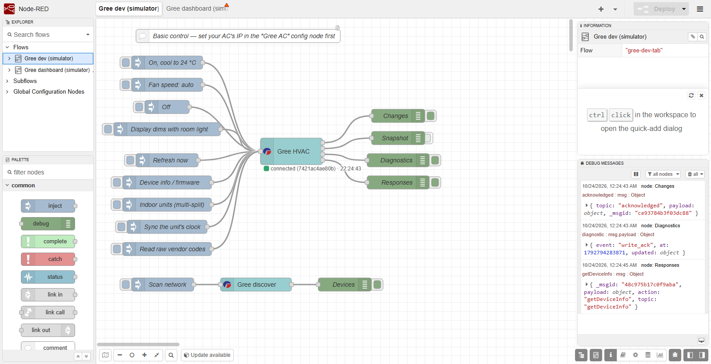
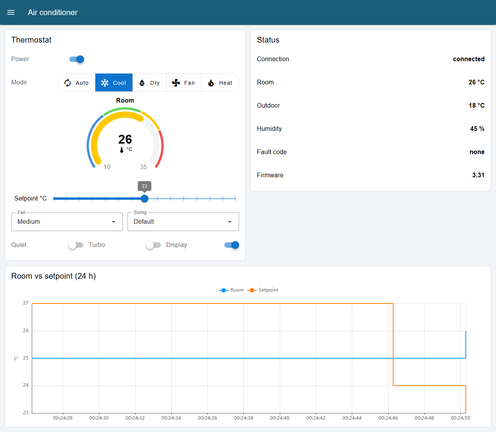
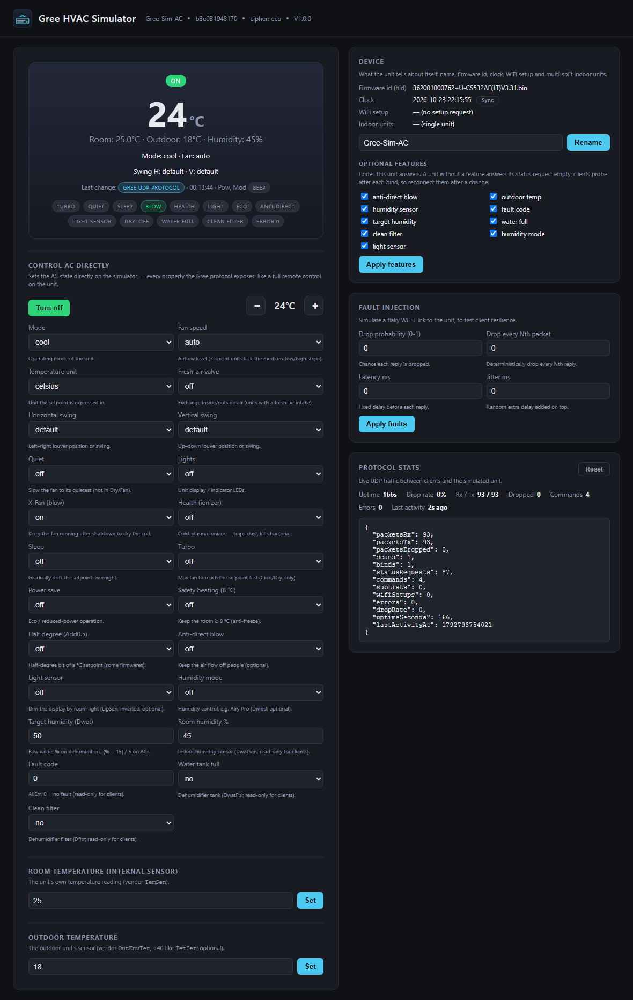

<p align="center">
  
</p>

<h1 align="center">node-red-contrib-gree-hvac</h1>

<p align="center">
  Node-RED nodes to control Gree air-conditioners over their UDP/AES protocol —
  with a full software simulator so you can build and test without the hardware.
</p>

<p align="center">
  <a href="https://github.com/apachler/node-red-contrib-gree-hvac/releases/latest"></a>
  <a href="https://github.com/apachler/node-red-contrib-gree-hvac/actions/workflows/ci.yml"></a>
  <a href="https://github.com/apachler/node-red-contrib-gree-hvac/actions/workflows/ci.yml"></a>
  <a href="https://github.com/apachler/node-red-contrib-gree-hvac/actions/workflows/codeql.yml"></a>
  <a href="https://github.com/apachler/node-red-contrib-gree-hvac/actions/workflows/release.yml"></a>
  <a href="https://securityscorecards.dev/viewer/?uri=github.com/apachler/node-red-contrib-gree-hvac"></a>
  <a href="LICENSE"></a>
  <a href="https://prettier.io"></a>
</p>

Provides nodes to control Gree HVAC (heating, ventilation, and air conditioning) units.

Designed for unattended 24/7 operation: the node keeps one client connected for as long as it runs, and the client recovers by itself — connect retries with back-off, a re-bind after missed polls with a recovery pause first, and a new UDP socket for every attempt — so a wedged Gree WiFi module recovers without a physical power cycle. Writes made while the unit is away are held and sent after the re-bind. See [Connection and recovery](#connection-and-recovery) and [CHANGELOG.md](CHANGELOG.md).

Nodes
-----

- `gree-hvac` — control and observe a single HVAC unit. Four outputs:
  1. **Changes** — `updated` (delta from the device) or `acknowledged` (delta from a write).
  2. **Snapshot** — full current property map.
  3. **Diagnostics** — structured events (`state`, `error`, `queue_overflow`, `heartbeat`, `update`, `write_ack`, `device_info`) with metrics for alerting and dashboards.
  4. **Responses** — answers to `msg.action` requests (device info, raw vendor codes, clock, name, multi-split indoor units, poll now).
- `gree-hvac-discover` — broadcast-scans the subnet and returns the responding devices (MAC, IP, name, firmware, number of multi-split indoor units) for populating config nodes; it also joins a unit in setup mode to your WiFi (`msg.action = "configureWifi"`).
- `gree-hvac-config` — host + UDP port of a single device, with optional **resolve-by-MAC** to follow the device across DHCP IP changes, the **indoor unit** of a multi-split system, and the unit's firmware options (half-degree setpoints, encoded target humidity, status batch size).

The node also publishes a live metrics snapshot under `context().get('gree')` (state, uptime, last contact, no-response streak, reconnect attempt and reason, queue size, device info).

Built on [`gree-hvac-client`](https://github.com/apachler/gree-hvac-client) 4.4, so it covers everything the client does: self-recovering connections, all 26 properties (incl. outdoor temperature, humidity, fault code, target humidity / humidity mode, anti-direct-blow, light sensor and the dehumidifier tank/filter flags on units that have them), Fahrenheit and half-degree setpoints, silent (no-beep) commands, multi-split systems, firmware info with a warning for cloud-only firmwares, raw vendor codes, the unit's clock and name, discovery and WiFi setup.

Install
-------

> **Heads-up:** this is a maintained fork. The `node-red-contrib-gree-hvac` package on the npm registry is still the original upstream **0.3.0** — this fork is **not published to npm yet**. Until it is, install from a GitHub Release tarball (below).

### From a GitHub Release tarball (recommended)

Each GitHub Release ships a packaged `.tgz` you can install directly. Run this in your Node-RED user directory — typically `~/.node-red`:

```
cd ~/.node-red
npm install https://github.com/apachler/node-red-contrib-gree-hvac/releases/download/v<version>/node-red-contrib-gree-hvac-<version>.tgz
```

Or download the `.tgz` from the [Releases page](https://github.com/apachler/node-red-contrib-gree-hvac/releases) and run `npm install ./node-red-contrib-gree-hvac-<version>.tgz` from your `~/.node-red` directory. Restart Node-RED after installation. This also pins a specific release.

Installing needs network access: the package pulls its dependency [`gree-hvac-client`](https://github.com/apachler/gree-hvac-client) from that project's GitHub Release, and the client's own dependencies from the npm registry. For an offline instance, install on a connected machine with the same Node.js major version and copy the resulting `node_modules` over.

Each release also carries a signed build-provenance attestation for the `.tgz` and a CycloneDX SBOM (`*.cdx.json`) of its runtime dependencies. To check that a downloaded tarball was built by this repo's release workflow:

```
gh attestation verify node-red-contrib-gree-hvac-<version>.tgz -R apachler/node-red-contrib-gree-hvac
```

### From the Node-RED editor (no shell)

1. Download `node-red-contrib-gree-hvac-<version>.tgz` from the [Releases page](https://github.com/apachler/node-red-contrib-gree-hvac/releases).
2. In the editor open **☰ Menu → Manage palette → Install**, click the **upload** button next to the search box, and pick the `.tgz`.
3. Confirm; Node-RED installs it and adds the nodes without a restart.

The upload button is missing when the instance disables it (`editorTheme.palette.upload: false` in `settings.js`); use the command line then. The install also needs network access, see above.

### Node-RED in Docker

With the official `nodered/node-red` image the user directory is `/data` (keep it on a volume, or the install is lost when the container is recreated):

```
docker exec -it <container> bash -c "cd /data && npm install https://github.com/apachler/node-red-contrib-gree-hvac/releases/download/v<version>/node-red-contrib-gree-hvac-<version>.tgz"
docker restart <container>
```

Or upload the `.tgz` in the editor as above. The UDP traffic to the AC must reach your LAN: on a bridge network, connecting by IP works; discovery and **Resolve by MAC** use broadcasts, which need `--network host` (or a macvlan network).

### Check, update, remove

- **Check:** the palette shows `gree-hvac` and `gree-hvac-discover` under _devices_, and **Import → Examples → node-red-contrib-gree-hvac** has the `basic-control` flow. **☰ Menu → Manage palette → Nodes** shows the installed version.
- **Update:** install the newer release's `.tgz` the same way (it replaces the old one), then restart Node-RED.
- **Remove:** **Manage palette → Nodes → remove**, or `npm uninstall node-red-contrib-gree-hvac` in the user directory and restart. Remove the nodes from your flows first.

Requires Node-RED 3.0 or newer on Node.js 18 or newer.

### From npm

Once this fork is published to npm, you'll be able to install it the usual way from your `~/.node-red` directory:

```
npm install node-red-contrib-gree-hvac
```

Until then, check the installed version — the registry currently serves the unmaintained upstream 0.3.0, not this fork.

Usage
-----

The package gives you the three nodes above — wire `gree-hvac` into whatever dashboard or automation you like. To get started, import the bundled example (see [Example flow](#example-flow) below).

For what each property and value means, see the [**Gree protocol & property reference**](docs/PROTOCOL.md).

### Following a device across DHCP changes (resolve by MAC)

If your AC gets its address from DHCP, its IP can change and break a hard-coded
host. Enable **Resolve by MAC** on the `gree-hvac-config` node and enter the
device's **MAC** (the `mac` field returned by `gree-hvac-discover`). The client
then scans the **Broadcast** address and binds only to the unit with that MAC.
When the unit moves, its polls go unanswered; after **No-response threshold**
missed polls and the **Recovery delay** the client scans again and finds the
unit at its new address — no flow edits, no restart.

- The **IP Address** field is not used while resolve by MAC is on.
- Set **Broadcast** (default `255.255.255.255`) to your subnet's broadcast
  address if global broadcast is filtered.
- Detection takes about _no-response threshold × polling interval + recovery
  delay_ (≈ 45 s with the defaults). The move shows on output 3 as a
  `reconnecting` state with reason `no_response`, then `connected`.
- Broadcasts must reach the unit: with Node-RED in Docker that needs host
  networking (see [Node-RED in Docker](#node-red-in-docker)). A DHCP reservation
  for the AC is the alternative.

### Connection and recovery

The `gree-hvac` node keeps one [`gree-hvac-client`](https://github.com/apachler/gree-hvac-client)
connected for as long as it runs; the client recovers by itself and never needs a
restart:

- **Connecting**: a scan + bind attempt per **Connect timeout**, backing off
  (doubling) up to **Max backoff**.
- **Unit stops answering**: after **No-response threshold** missed polls the
  client drops the binding, sends nothing for **Recovery delay** — time for a
  struggling WiFi module to recover instead of being flooded — then scans again,
  backing off up to **Max backoff** while it stays away.
- **New socket per attempt**: every reconnect opens a new UDP socket, which is
  what un-wedges some WiFi modules short of a power cycle; a socket error starts
  recovery too.
- **Writes while away** are held in the node's queue (the same property
  collapses to its latest value; at most **Max queued writes**, oldest dropped
  with a `queue_overflow` diagnostic) and sent once the unit is bound again.
  Turn on **Reject inputs while offline** to fail them instead.
- **Requests** (`msg.action`) are not held: they fail at once while offline.

Each step is reported on output 3 — `state` diagnostics `connecting` →
`connected`, `no_response` (with the streak), `reconnecting` (with `attempt`,
`reason` `connect_timeout` / `no_response` / `socket_error` and `delayMs`) —
and in the node status. Client errors are reported as `error` diagnostics only;
they never stop the node. Use a **Heartbeat interval** to alert on silence.

### Setting properties

Send `msg.payload` as a property object — `{"power":"on","mode":"cool","temperature":24}` — or `msg.topic` = property name with `msg.payload` = value. Unknown properties, read-only ones (`currentTemperature`, `outdoorTemperature`, `humidity`, `errorCode`, `waterFull`, `cleanFilter`) and invalid values are dropped with a warning before anything is sent. `temperature` is in the unit's `temperatureUnit`: whole °F when the unit is in Fahrenheit, whole °C — or half °C (`23.5`) with **Half-degree °C setpoints** on the config node, for firmwares that take them.

Optional properties (`antiDirectBlow`, `outdoorTemperature`, `humidity`, `errorCode`, `targetHumidity`, `humidityMode`, `lightSensor`, `waterFull`, `cleanFilter`) exist only on some units: the client asks the unit once after each connect and polls them only when it answers, so they appear in the outputs only on units that have them.

Turn on **Silent** on the `gree-hvac` node to ask the unit not to beep on each command.

### Requests (`msg.action`)

Besides setting properties, `gree-hvac` takes requests in `msg.action`; the answer is the same `msg` with `topic` = the action and `payload` = the answer, on output 4. Failures go to `done(err)` (catch nodes); requests are not queued, so they fail at once while the device is offline.

| `msg.action`          | `msg.payload`                                      | Answer                                                                                       |
| --------------------- | -------------------------------------------------- | -------------------------------------------------------------------------------------------- |
| `getProperties`       | —                                                  | all current properties, polled now                                                           |
| `getDeviceInfo`       | —                                                  | `{mac, name, version, model, brand, hid, firmwareVersion, moduleType, ..., upgradeWarning?}` |
| `getSubUnits`         | — (optional `msg.timeout` ms)                      | multi-split: `[{mac, mid}]` of the indoor units, `[]` for a single unit                      |
| `getVendorProperties` | vendor code or array, e.g. `["UvcControl","time"]` | `{code: raw value}`; codes the unit does not know are missing                                |
| `setVendorProperties` | `{code: value}`, sent raw                          | what was sent                                                                                |
| `getClock`            | —                                                  | the unit's clock, `YYYY-MM-DD HH:MM:SS`                                                      |
| `setClock`            | Date, timestamp or date string; empty = now        | the time set, in this host's local time                                                      |
| `setName`             | new name                                           | the name                                                                                     |

### Firmware updates can end local control

Some Gree WiFi-module firmwares were switched to cloud-only in later builds: once upgraded, the unit no longer answers on the LAN at all. After each connect the node reads the unit's firmware id, publishes it as a `device_info` diagnostic (and as `deviceInfo` in the runtime context), and — for a firmware known to have such builds — logs a warning once. Don't upgrade that unit's WiFi-module firmware in the vendor app. The list of firmwares is maintained in [`gree-hvac-client`](https://github.com/apachler/gree-hvac-client#firmware-updates-can-end-local-control).

### Multi-split systems

On a multi-split system only the outdoor unit's WiFi module is on the network. `gree-hvac-discover` reports it with `subUnits` > 0. Point a `gree-hvac` node at it and send `msg.action = "getSubUnits"` to list the indoor units, then create one `gree-hvac-config` per indoor unit — same IP (or MAC), with that unit's MAC as **Indoor unit** — and one `gree-hvac` node per config. The multi-split support follows community reverse-engineering and has not been verified on hardware by this project.

### WiFi setup

A unit whose WiFi was reset (MODE + WIFI, or MODE + TURBO, on the remote for 5 s) opens its own access point. With the Node-RED host joined to it, send `gree-hvac-discover` a message with `msg.action = "configureWifi"` and `msg.payload = {"ssid": "...", "password": "..."}`: the unit joins your network (answer `{confirmed, mac}` with topic `gree-wifi-setup`; some firmwares never confirm, so check with a scan). The password is not passed on in the output message.

### Example flow

A ready-to-run flow ships with the package: in the Node-RED editor, open **☰ Menu → Import → Examples → node-red-contrib-gree-hvac → basic-control**. It uses only core nodes (inject, debug, comment) besides ours, so it imports on any Node-RED 3+ — no dashboard package needed.

<p align="center">
  
</p>

To use it:

1. Double-click **Gree HVAC**, edit its **Gree AC** config node and set **IP Address** to your AC's IP — click **Scan network** first to find it — or turn on **Resolve by MAC**.
2. **Deploy**. The node's status turns green with the unit's MAC once it is bound.
3. Click the inject buttons and watch the **debug** sidebar.

| Button                       | Sends                                                            | Answer on                          |
| ---------------------------- | ---------------------------------------------------------------- | ---------------------------------- |
| On, cool to 24 °C            | `msg.payload = {"power":"on","mode":"cool","temperature":24}`    | Changes (`acknowledged`), Snapshot |
| Fan speed: auto / Off        | `msg.topic` = property, `msg.payload` = value                    | Changes, Snapshot                  |
| Display dims with room light | `{"lights":"on","lightSensor":"on"}` (units with a light sensor) | Changes, Snapshot                  |
| Refresh now                  | `msg.action = "getProperties"`                                   | Responses                          |
| Device info / firmware       | `msg.action = "getDeviceInfo"`                                   | Responses                          |
| Indoor units (multi-split)   | `msg.action = "getSubUnits"`                                     | Responses (`[]` for a single unit) |
| Sync the unit's clock        | `msg.action = "setClock"` with the inject timestamp              | Responses                          |
| Read raw vendor codes        | `msg.action = "getVendorProperties"`, `["hid","time"]`           | Responses                          |
| Scan network                 | a discovery scan on **Gree discover**                            | Devices                            |

The four debug nodes are the `gree-hvac` outputs: **Changes** (what changed, from the unit or after a write), **Snapshot** (all properties, off by default — enable it to see every poll), **Diagnostics** (connection state, errors, heartbeat, `device_info`) and **Responses** (answers to `msg.action`). Copy what you need into your own flows; the help panel of each node lists every input and output. The [Docker stack](#development-with-the-simulator) loads the same flow, pointed at the simulator.

### Dashboard example (thermostat)

A second example, **dashboard-thermostat**, puts one unit on a [Dashboard 2.0](https://dashboard.flowfuse.com/) page: power, mode, setpoint, fan, swing and quiet / turbo / display switches, the room temperature as a gauge, a status card (connection, room, outdoor, humidity, fault code, firmware) and a 24 h chart of room temperature against the setpoint.

<p align="center">
  
</p>

1. Install **`@flowfuse/node-red-dashboard`** (**☰ Menu → Manage palette → Install**) — this example needs it; `basic-control` doesn't.
2. Import **☰ Menu → Import → Examples → node-red-contrib-gree-hvac → dashboard-thermostat**.
3. Set the **Gree AC (dashboard)** config node's IP Address (or resolve by MAC), deploy, and open `http://<node-red>:1880/dashboard`.

How it's wired, if you want to build your own:

- Each control sends `msg.topic` = property and `msg.payload` = value into the `gree-hvac` node — the topic form of its input. The setpoint slider sends on release only.
- A **Properties → widgets** function feeds controls, readouts and chart from the node's **Snapshot** output (after every change) and from a `getProperties` request every minute (answered on **Responses**).
- The widgets have **pass-through off**, so a change made on the unit (remote control, app) updates the page without echoing back as a command.
- A **Diagnostics → status** function shows the connection state and the firmware; readouts the unit has no sensor for show "—".

Protocol
--------

The Gree UDP/AES wire protocol and every device property (vendor code, values, and what each feature actually does — `air`, `blow`/X-Fan, `health`, `sleep`, `quiet`, `turbo`, `powerSave`, `safetyHeating`, …), plus Fahrenheit / half-degree setpoints, multi-split, firmware id, clock, beeper and WiFi setup, are documented in [**docs/PROTOCOL.md**](docs/PROTOCOL.md). The simulator implements it byte-for-byte, so it doubles as an executable spec.

Development setup
-----------------

After cloning, run `npm install` once — the `prepare` script wires up `core.hooksPath` to `./.githooks/` so two git hooks run: **commit-msg** rejects commit subjects that aren't [Conventional Commits](https://www.conventionalcommits.org/), and **pre-push** runs `eslint --fix` against the whole repo before every push. Pushes are refused if eslint reports errors it couldn't auto-fix, or if `--fix` produced changes that haven't been staged + committed (so the fix lands in a reviewable commit, not silently on the remote).

Skip the hooks in an emergency with `GREE_SKIP_LINT=1 git commit ...` / `GREE_SKIP_LINT=1 git push ...`. CI sets `CI=true` so the hooks are a no-op in workflows (CI runs `npm run lint` itself anyway).

Development with the simulator
------------------------------

The repo ships a software simulator of a Gree HVAC device, so you can develop and test the nodes without owning hardware. The simulator implements the same UDP protocol (AES-ECB / AES-GCM) the real device speaks, and exposes a small HTTP dashboard that visualizes the AC state in real time.

<p align="center">
  
</p>

The dashboard shows live AC state and the **source** of each change ("Gree UDP protocol" when a client sets a value over the wire, "HTTP API" for a direct dashboard/REST action), plus controls to drive the AC directly (every protocol property, the unit's own room and outdoor temperature readings, its optional features, clock and name), inject faults (packet drop / latency / jitter), and watch live UDP protocol stats.

> The dashboard screenshots in this README are generated, not hand-placed — regenerate them with `node docs/screenshot.mjs` against a running stack (see [`docs/`](docs/)). `docs/demo.tape` renders an optional terminal demo GIF via [`vhs`](https://github.com/charmbracelet/vhs); it's also wired into the manual **Docs media** workflow.

### Requirements

- Docker + Docker Compose v2 (`docker compose` subcommand)
- Node.js 22 LTS on the host (matches `.nvmrc`; needed for the dev toolchain and e2e tests — the containers ship their own Node)

### Bring up the stack

```bash
npm run sim:up      # docker compose up -d --build
```

This starts two services:

| Service    | URL                   | What it is                                                                                                                                  |
| ---------- | --------------------- | ------------------------------------------------------------------------------------------------------------------------------------------- |
| `gree-sim` | http://localhost:8080 | Simulator dashboard (live AC state, direct controls, fault injection, protocol stats)                                                       |
| `gree-sim` | udp://localhost:7000  | Gree protocol endpoint (also reachable in-cluster as `gree.lan`)                                                                            |
| `node-red` | http://localhost:1880 | Node-RED with the contrib nodes + both example flows pre-loaded, pointed at the sim; the thermostat page at http://localhost:1880/dashboard |

The pre-loaded flows are the two examples, [`basic-control`](examples/basic-control.json) and [`dashboard-thermostat`](examples/dashboard-thermostat.json), one tab each, with their `gree-hvac-config` host set to `gree.lan` (`docker/nodered/build-flows.js`, at image build time); the sim container is aliased as `gree.lan` on the docker network. The image includes Dashboard 2.0 (`@flowfuse/node-red-dashboard`, pinned in `docker/nodered/package.json`). Fire the inject buttons in the editor, or use the thermostat page, and watch the AC change on the sim dashboard — or change it on the sim dashboard and watch the thermostat page follow.

The ports are published on `127.0.0.1` only, because neither the sim dashboard nor the Node-RED editor has authentication. To open them to other machines on a trusted network, start the stack with `GREE_BIND=0.0.0.0 npm run sim:up`.

Tail logs and tear down:

```bash
npm run sim:logs
npm run sim:down    # also removes the network
```

### Simulator configuration

The simulator is configured by environment variables (`docker-compose.yml`, or the shell for `node sim/bin/gree-sim.js`):

| Variable                                                                                 | Default                               | What it does                                                                                                                                       |
| ---------------------------------------------------------------------------------------- | ------------------------------------- | -------------------------------------------------------------------------------------------------------------------------------------------------- |
| `GREE_SIM_UDP_PORT` / `GREE_SIM_HTTP_PORT`                                               | `7000` / `8080`                       | Gree protocol port / dashboard port                                                                                                                |
| `GREE_SIM_CIPHER`                                                                        | `ecb`                                 | `ecb` (older firmwares) or `gcm` (newer)                                                                                                           |
| `GREE_SIM_NAME` / `GREE_SIM_CID`                                                         | random                                | device name and MAC (`cid`)                                                                                                                        |
| `GREE_SIM_VERSION`                                                                       | `V1.0.0`                              | WiFi module version in the scan answer                                                                                                             |
| `GREE_SIM_HID`                                                                           | `362001000762+U-CS532AE(LT)V3.31.bin` | firmware id answered for the `hid` status column; set a code from the cloud-only list to see the firmware warning, or empty for a unit without one |
| `GREE_SIM_FEATURES`                                                                      | `all`                                 | optional features the unit has: `all`, `none`, or a comma-separated list such as `outdoorTemperature,humidity`                                     |
| `GREE_SIM_SUB_UNITS`                                                                     | unset                                 | multi-split gateway: a count of indoor units (MACs `<cid>01`, `<cid>02`, …) or a comma-separated list of MACs                                      |
| `GREE_SIM_DROP_PROB`, `GREE_SIM_DROP_EVERY`, `GREE_SIM_LATENCY_MS`, `GREE_SIM_JITTER_MS` | `0`                                   | fault injection from the start (also on the dashboard)                                                                                             |
| `GREE_SIM_VERBOSE`                                                                       | off                                   | log every protocol event                                                                                                                           |

Like a real unit, the simulator answers a status request only for the codes it knows: a feature it lacks is missing from the answer, so the client never polls it. The dashboard's **Device** panel toggles the features at runtime (clients re-probe them on their next connect), shows the firmware id, the clock (with a sync button), the name and the SSID of the last WiFi setup, and — in gateway mode — selects which indoor unit the dashboard shows and controls.

### Hot-reload while iterating on the nodes

`npm run sim:dev` brings the stack up with the host's `gree-hvac/` source bind-mounted over the image's installed copy and Node-RED wrapped in `nodemon`, so edits to `gree-hvac/*.js` or `gree-hvac/*.html` trigger a runtime restart within ~2 seconds:

```bash
npm run sim:dev          # foreground; Ctrl+C to stop
npm run sim:dev:down     # tear down the dev stack
```

What's mounted: `./gree-hvac/` → `/data/node_modules/node-red-contrib-gree-hvac/gree-hvac/` (read-only) and `./package.json` → the same package's package.json. Flow edits made in the editor live in the container's `/data` and are lost when it is recreated.

Node-RED does not hot-reload nodes in place — `nodemon` restarts the whole runtime on change, so the editor will briefly lose its WebSocket and reconnect. The browser tab survives the restart; just re-deploy if you were mid-edit. Use `npm run sim:up` (the production-like mode) when you want stable behavior for the e2e suite or for letting flows run unattended.

### Run the tests

**Unit tests** (no docker required):

```bash
npm test           # contrib nodes + their libs, against the in-process simulator
npm run test:sim   # the simulator itself
```

**End-to-end tests** against the live compose stack — boots the stack, exercises the simulator over UDP using the real `gree-hvac-client`, drives the deployed Node-RED flow via its admin API, injects packet drops to verify the connection-manager's recovery, and tears the stack down:

```bash
npm run test:e2e
```

Useful env vars while iterating:

- `E2E_SKIP_BUILD=1` — reuse the existing images (skip `docker compose build`)
- `E2E_KEEP_UP=1` — leave the stack running after the tests finish so you can poke at it

### What's actually being tested

| Test file                             | What it covers                                                                                                                                                                                                                                                                              |
| ------------------------------------- | ------------------------------------------------------------------------------------------------------------------------------------------------------------------------------------------------------------------------------------------------------------------------------------------- |
| `test/connection-manager.test.js`     | The adapter around the client (stubbed): option mapping, state/diagnostics from the client events, writes held while offline, coalescing queue, refused-property handling, `call()`, stop                                                                                                   |
| `test/validation.test.js`             | Unknown, read-only and invalid properties are dropped before a write                                                                                                                                                                                                                        |
| `test/examples.test.js`               | The shipped `examples/` flows: core node types only (Dashboard 2.0 types for the dashboard example, which names its package), wires resolve, every editor default set, inject payloads pass validation, inject actions exist, dashboard widgets send valid properties with pass-through off |
| `test/gree-hvac-node.test.js`         | The three nodes on a fake Node-RED runtime, over real UDP to the in-process sim: outputs, input forms, validation, `msg.action` requests, device info, offline rejection, recovery of a unit that stops answering, heartbeat, resolve-by-MAC, discovery                                     |
| `sim/test/simulator.test.js`          | Wire-level: discovery, bind, status, cmd, fault injection — without involving the contrib nodes                                                                                                                                                                                             |
| `sim/test/client-roundtrip.test.js`   | Real `gree-hvac-client` connecting to the in-process simulator over loopback                                                                                                                                                                                                                |
| `sim/test/client-features.test.js`    | The real `gree-hvac-client` against the sim: feature probing, every optional property, °F / half-degree setpoints, device info + firmware warning, clock, name, raw codes, silent, multi-split, discovery, WiFi setup                                                                       |
| `sim/test/dashboard.test.js`          | The sim's HTTP API and SSE stream: state, set, temperature, faults, stats, body limits                                                                                                                                                                                                      |
| `sim/test/cipher-faults.test.js`      | ECB/GCM ciphers, fault injector, and a real client binding over AES-GCM                                                                                                                                                                                                                     |
| `test/e2e/sim.e2e.test.js`            | Dashboard HTTP API + client round-trip against the dockerized sim                                                                                                                                                                                                                           |
| `test/e2e/nodered.e2e.test.js`        | Node-RED admin API: the example flow is deployed with `gree-hvac-config` on `gree.lan`; firing its inject nodes drives the simulated AC on and off; the dashboard example is deployed and its page served                                                                                   |
| `test/e2e/fault-recovery.e2e.test.js` | Sets `dropEvery: 3` on the sim and verifies a real state change still gets through                                                                                                                                                                                                          |

Contributing
------------

Contributions are welcome! See [CONTRIBUTING.md](CONTRIBUTING.md) for the dev
setup, the git hooks, the testing commands, and the Conventional-Commit
PR-title convention that drives the release notes. Please also read the
[Code of Conduct](CODE_OF_CONDUCT.md). For where the project is headed see the
[Roadmap](ROADMAP.md), and for how it's run see [Governance](GOVERNANCE.md).

Support
-------

For usage questions and how-to help, see [SUPPORT.md](SUPPORT.md). For what each
Gree property and value means, see [docs/PROTOCOL.md](docs/PROTOCOL.md).

Security
--------

Please report security vulnerabilities privately — do **not** open a public
issue. See the [security policy](SECURITY.md).

License
-------

[MIT](LICENSE) © Igor Starovierov and contributors.

This package requires [`gree-hvac-client`](https://github.com/apachler/gree-hvac-client)
at runtime, which is licensed under **GPL-3.0**. It is installed as a separate
dependency, not bundled — but anything you distribute that ships both together
(a Node-RED installation, a container image, an appliance) must comply with
GPL-3.0 as a whole. See [NOTICE](NOTICE).

Acknowledgements
----------------

- Built on [`gree-hvac-client`](https://github.com/apachler/gree-hvac-client)
  (maintained fork of [inwaar/gree-hvac-client](https://github.com/inwaar/gree-hvac-client))
  for the UDP/AES wire protocol.
- Originally authored by [Igor Starovierov](https://github.com/inwaar); currently
  maintained by [Andreas Pachler](https://github.com/apachler).
